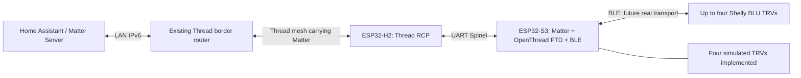

# Shelly BLU Matter Bridge

An **experimental**, Apache-2.0 gateway prototype for Shelly BLU TRVs: **Matter over
Thread upstream, BLE downstream**, on the Espressif ESP32-S3 + ESP32-H2 Main Board.
The first deliverable is a foundation and simulator. **Full replacement feasibility
has not been established. Real TRV communication is not implemented.**

**Publication gate:** keep this repository private until a working MVP has been
validated. The current software-only foundation does not pass that gate.

> This project is independent and unaffiliated with Shelly. It is not presented as
> certified by Shelly, the Connectivity Standards Alliance, or any other body.
> Validate it before production use. It is provided without warranty. To the extent
> permitted by applicable law and the [Apache-2.0 license](LICENSE), contributors
> disclaim liability, including for damage arising from use or improper use.
> This notice adds no restrictions to the license. See its warranty and liability terms.



The gateway joins the existing Thread network. It uses no gateway Wi-Fi, cloud,
Ethernet backbone, Zigbee, or additional border-router role. FTD router eligibility
allows Thread to elect it as a router; a permanent router role is not promised.
TRVs retain their vendor firmware. Heating algorithms, temperature limits and
boiler control belong in Home Assistant; firmware translates and reconciles state.
Simulator input bounds are protocol validation, not a heating algorithm.

## Status and hardware

| Capability | Planned interface | Implemented | Validated |
| --- | --- | --- | --- |
| Temperature, setpoint, Off/Heat | Thermostat | Simulator + Matter model | Host core tests; HA pending |
| Valve percentage and feedback | Valve Configuration and Control, Level feature | Simulator + child valve endpoint | Host fault tests; conformance/HA pending |
| Battery | Power Source | Simulated percentage | Conversion in model; HA pending |
| Identity, availability | Bridged Device Basic Information | Stable slots + separate NVS identity | Host identity tests; hardware persistence pending |
| Thread FTD without Wi-Fi | S3 host / H2 UART RCP | Build configuration and runtime setup | Cross-build only; RF/commissioning pending |
| BLE after commissioning | NimBLE central/observer | Enabled in configuration | No Shelly BLE client yet |
| Gateway OTA | Matter OTA Requestor | Enabled; two S3 slots and boot rollback check | Installation/rollback pending |
| Maintenance and TRV updates | Standard mappings under investigation | Documentation only | Release blockers |

Use an **ESP Thread BR-Zigbee GW Main Board Only**, USB-C data cables and stable 5 V
power. Verify the received board has **at least 8 MB S3 flash** before flashing this partition
layout; older 4 MB units require a different layout. No Ethernet Sub Board is needed.
Hardware validation also needs an existing Thread border router, Home Assistant,
Matter Server **9.3.0** as the OTA validation target, and eventually one then four TRVs.

## Reproducible development

Linux/WSL with Docker, Python 3 and Git is sufficient. The [official SDK base image](https://docs.espressif.com/projects/esp-matter/en/latest/esp32/developing.html#using-docker-image)
is pinned by digest in [toolchain.lock.json](tools/toolchain.lock.json). The development
recipe upgrades it to ESP-Matter 1.6.1 and ESP-IDF 6.1.1 with locked build tools.
See [current versions and workflow purposes](docs/development-versions.md). Run:

```sh
./tools/dev.sh python3 tools/check_toolchain.py
./tools/dev.sh bash -c 'cmake -S . -B build/host -G Ninja && cmake --build build/host && ctest --test-dir build/host --output-on-failure'
./tools/dev.sh build/host/bridge_simulator
python3 -m unittest discover -s tests -p 'test_*.py'
./tools/dev.sh idf.py -C firmware set-target esp32s3 build
./tools/dev.sh python3 tools/check_firmware_config.py
```

Host builds also work with CMake 3.20+, Ninja and a C++17 compiler. The demo injects
an unconfirmed position, an absent valve and a transient failure across four slots.
Tests cover invalid inputs, expiry, obsolete commands, manual changes, reconnect,
independent recovery and identity stability. Follow [prototype instructions](docs/prototype.md)
for flashing, USB fault injection and H2 RCP preparation. Containers need network
access for the first dependency resolution. The SDK and generated dependency locks
must be reviewed together when upgrading.

## Documentation and contribution entry points

- [Architecture and decisions](docs/architecture.md), [hardware and commissioning](docs/commissioning.md)
- [BLE operations](docs/ble-protocol.md), [capability matrix and release blockers](docs/matter-mapping.md)
- [Home Assistant migration and Better Thermostat proposal](docs/home-assistant.md)
- [Gateway OTA and separate TRV update investigation](docs/updates.md)
- [Validation gates](docs/validation/README.md), [current results](docs/validation/results.md)
- [Contributing](CONTRIBUTING.md), [maintainers](MAINTAINERS.md), [security](SECURITY.md), [conduct](CODE_OF_CONDUCT.md)
- [Dependency notices](THIRD_PARTY_NOTICES.md), [release conventions](docs/releases.md)

The initial target is four TRVs per gateway. A pilot requires at least 14 consecutive
days without manual recovery, then seven valves across two gateways. Standard Matter
clusters exclusively: any required function without a legitimate mapping or a passing
acceptance test blocks a full-parity release. Hardware and controller results must be
recorded before changing the status table.
